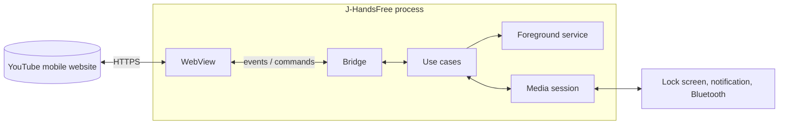

# J-HandsFree

Hands-free YouTube for Android.

Keep listening with the screen off or while another app, such as your navigator, is in front. Skippable ads are skipped automatically the moment the player shows the **Skip** button, so you never have to touch the screen while driving.

> **Status:** phase 1 (foundations) is done and v0.1.0 is released. The app starts and shows its version, but does not play anything yet. Phase 2, the domain and use cases, is next. See the [roadmap](docs/ROADMAP.md).

---

## Why this exists

The official app pauses playback when the screen turns off or when you switch to another app, unless you pay for a subscription. Podcasts, long talks and personal playlists are exactly what you want to listen to while driving with a navigator open. J-HandsFree is a personal tool built around one rule: **once playback starts, you should not need to touch the phone.**

## Planned features (v1)

| Feature | What it does |
| --- | --- |
| Background playback | Audio keeps playing with the screen off or while another app is in the foreground. |
| Automatic ad skip | Watches the player and presses **Skip** as soon as YouTube offers it. Nothing is blocked; non-skippable ads play normally. |
| System media controls | Play, pause and next from the lock screen, the notification, headphones and the car's Bluetooth controls. |
| Signed-in session | Your subscriptions and personal playlists through the YouTube mobile website. |
| Auto-dismiss idle prompt | Confirms "Continue watching?" automatically during long listening sessions. |

More candidate features are evaluated in [FEATURES.md](docs/FEATURES.md).

## How it works

The app hosts the official YouTube mobile website inside an Android WebView. Small injected scripts observe the player and report events to the C# core, which decides what to do and sends commands back. A foreground service keeps the app alive while the screen is off. Full details are in the [architecture document](docs/architecture/ARCHITECTURE.md).

## Tech stack

| Area | Choice |
| --- | --- |
| Platform | .NET MAUI on .NET 10 (LTS), Android only |
| Architecture | Clean Architecture with ports and adapters, MVVM in the UI |
| In-process messaging | Mediator 3.0.2 (source-generated, no reflection) |
| Media | AndroidX Media3 session, foreground service of type `mediaPlayback` |
| Injected scripts | TypeScript, bundled into a single file |
| Tests | xUnit, Shouldly, NSubstitute, Vitest for scripts |
| CI/CD | GitHub Actions, signed APK published to GitHub Releases |
| Distribution | GitHub Releases, installed and updated with Obtainium |

## Install

J-HandsFree is not published on any app store. Signed APKs are attached to each [GitHub release](../../releases).

The easiest way to install and receive updates is [Obtainium](https://github.com/ImranR98/Obtainium):

1. Install Obtainium on your Android phone.
2. Tap **Add App** and paste this repository's URL.
3. Tap **Install**. Obtainium notifies you when a new release is published.

## Build from source

See [DEVELOPMENT_SETUP.md](docs/DEVELOPMENT_SETUP.md).

## Documentation

| Document | Content |
| --- | --- |
| [Architecture](docs/architecture/ARCHITECTURE.md) | Layers, components, flows, state machine, message contract |
| [Architecture decisions](docs/adr/) | Why each major decision was made |
| [Feasibility spike](docs/spikes/0001-feasibility.md) | What phase 0 measured on a real phone |
| [Roadmap](docs/ROADMAP.md) | Phases, steps and definition of done |
| [Features](docs/FEATURES.md) | Requested and candidate features with priorities |
| [Risks](docs/RISKS.md) | Risk register and mitigations |
| [Coding standards](docs/CODING_STANDARDS.md) | Clean Code rules for C# and TypeScript |
| [Testing](docs/TESTING.md) | Test strategy and conventions |
| [Git workflow](docs/GIT_WORKFLOW.md) | Branches, protections, commits, versioning |
| [CI/CD](docs/CI_CD.md) | Pipelines, secrets, signing and releases |
| [Contributing](CONTRIBUTING.md) | How to propose a change |

## Disclaimer

J-HandsFree is an independent personal project. It is not affiliated with, endorsed by or sponsored by YouTube or Google LLC. YouTube is a trademark of Google LLC.

The app loads the official YouTube mobile website. It does not download, store or redistribute videos, and it does not block ads: it presses the Skip button that the player itself provides. Automating interaction with YouTube may conflict with the YouTube Terms of Service, and using this app is at your own risk.

## License

[MIT](LICENSE) © 2026 Gianluca Meola
