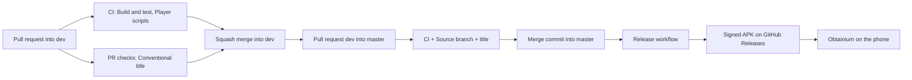

# CI/CD

All automation runs on GitHub Actions with GitHub-hosted Ubuntu runners. Standard runners are free for public repositories.

## Workflows

| File | Trigger | Jobs (check names) | Purpose |
| --- | --- | --- | --- |
| `.github/workflows/ci.yml` | Pull requests into `dev` or `master`, pushes to `dev`, manual | `Build and test`, `Player scripts` | Format check, build, unit tests with coverage, script lint, tests and bundle |
| `.github/workflows/pr-checks.yml` | Pull request opened, edited, updated | `Source branch`, `Conventional title` | Only `dev` may target `master`; titles are Conventional Commits |
| `.github/workflows/release.yml` | Push to `master`, manual | `Publish release` | Signed APK, tag `vX.Y.Z`, GitHub Release |
| `.github/dependabot.yml` | Weekly | Dependabot | Grouped updates for NuGet, npm and Actions, targeting `dev` |



The jobs fail closed: they run in full on every trigger, documentation-only changes included, and a missing solution, scripts project or app project fails the job instead of skipping it. A required check therefore turns green only after a real build and test run.

## Build environment

| Tool | Version | Why |
| --- | --- | --- |
| .NET SDK | 10.0.x | Matches `global.json` |
| .NET MAUI Android workload | Matching the SDK | `dotnet workload install maui-android`; works on Linux runners |
| JDK | Microsoft OpenJDK 21 | Recommended for .NET for Android builds |
| Android SDK | Preinstalled on the runner | Missing platforms are installed with the `InstallAndroidDependencies` target |
| Node.js | 24 LTS | Builds and tests the player scripts; the .NET build also runs npm to embed the script bundle |

## Quality gates

| Gate | Command |
| --- | --- |
| Formatting | `dotnet format --verify-no-changes` |
| Warnings as errors | `-p:ContinuousIntegrationBuild=true` enables `TreatWarningsAsErrors` through `Directory.Build.props` |
| Unit tests | `dotnet test` with coverage collection |
| Coverage threshold | Added in phase 2 for Domain and UseCases (90 percent) |
| Script quality | `npm run lint`, `npm test`, `npm run build` |
| Pull request title | Conventional Commit regular expression |
| Source branch | Only `dev` into `master` |

## Signing and secrets

### Create the keystore (once)

Run in PowerShell on your PC, **outside the repository folder**:

```powershell
New-Item -ItemType Directory -Force "$HOME\keys" | Out-Null
$keytoolArgs = @('-genkeypair', '-v', '-keystore', "$HOME\keys\j-handsfree.keystore", '-alias', 'jhandsfree', '-keyalg', 'RSA', '-keysize', '4096', '-validity', '10000')
keytool @keytoolArgs
```

`keytool` is part of the JDK. Choose a strong store password and key password and save both in your password manager.

**Back up the keystore file offline.** If it is lost, a new APK cannot update the installed app: every phone has to uninstall first.

### Store the secrets in GitHub

The release job uses the GitHub environment `release`, restricted to the `master` branch.

1. **Settings → Environments → New environment** → `release`. Under **Deployment branches and tags**, allow only `master`.
2. Add the environment secrets:

```powershell
$keystore = [Convert]::ToBase64String([IO.File]::ReadAllBytes("$HOME\keys\j-handsfree.keystore"))
gh secret set ANDROID_KEYSTORE_BASE64 --env release --body $keystore
gh secret set ANDROID_KEYSTORE_PASSWORD --env release
gh secret set ANDROID_KEY_ALIAS --env release --body "jhandsfree"
gh secret set ANDROID_KEY_PASSWORD --env release
Remove-Variable keystore
```

`gh secret set` without `--body` prompts for the value, so passwords never appear in the shell history.

| Secret | Content |
| --- | --- |
| `ANDROID_KEYSTORE_BASE64` | The keystore file encoded as Base64 |
| `ANDROID_KEYSTORE_PASSWORD` | Store password |
| `ANDROID_KEY_ALIAS` | `jhandsfree` |
| `ANDROID_KEY_PASSWORD` | Key password |

The release workflow decodes the keystore into the runner's temporary folder, passes the passwords through environment variables with the `env:` prefix so they never appear in build logs, and deletes the file at the end.

## Versioning in the build

- `ApplicationDisplayVersion` (the version shown to users) = `<VersionPrefix>` from `Directory.Build.props`.
- `ApplicationVersion` (Android version code, an integer that must always grow) = `MAJOR * 10000 + MINOR * 100 + PATCH`. For example, 1.2.3 becomes 10203.
- The release workflow passes both to `dotnet publish`. Local builds use the values in the project file.

## Installing releases with Obtainium

1. Install Obtainium from its GitHub releases or F-Droid.
2. **Add App** → paste `https://github.com/janlu89/J-HandsFree` → **Add**.
3. **Install**. Allow installs from Obtainium when Android asks.
4. Obtainium checks for new releases periodically and notifies you.

## Troubleshooting

| Symptom | Likely cause | Fix |
| --- | --- | --- |
| Release fails with "already released" | Merge into `master` without a version bump | Follow the release procedure in [GIT_WORKFLOW.md](GIT_WORKFLOW.md) |
| Phone refuses the update: "package conflicts" | APK signed with a different key | Restore the original keystore; uninstall only as a last resort |
| Status check missing in the ruleset picker | The workflow has not run yet | Open any pull request, then add the check |
| `InstallAndroidDependencies` fails with a permission error | The runner's SDK folder is read-only | Point `AndroidSdkDirectory` to a folder under `$RUNNER_TEMP` |
