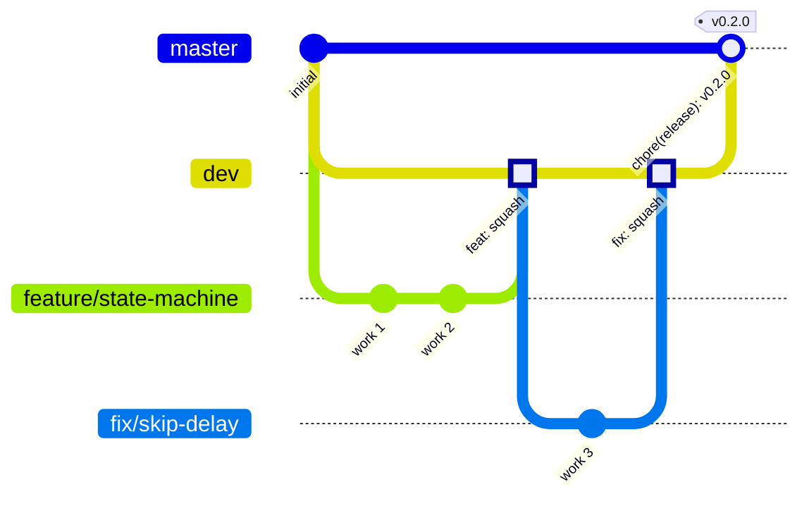

# Git workflow

## Branch model



| Branch | Purpose | Receives changes from | Protected |
| --- | --- | --- | --- |
| `master` | Released code. Every commit is a release. | `dev` only, through a pull request, merge commit | Yes |
| `dev` | Integration and test branch | Work branches, through a pull request, squash | Yes |
| `feature/*` | New behaviour | Direct commits | No, deleted after merge |
| `fix/*` | Bug fixes | Direct commits | No, deleted after merge |
| `refactor/*`, `test/*`, `docs/*`, `chore/*`, `ci/*` | Other work, named by Conventional Commit type | Direct commits | No, deleted after merge |
| `spike/*` | Throwaway experiments | Direct commits | No, never merged |

Why squash into `dev` but merge commits into `master`: see [ADR 0008](adr/0008-branching-and-merge-strategy.md).

## Daily flow

```powershell
git switch dev
git pull
git switch -c feature/playback-state-machine

# work, commit often with Conventional Commits
git add -A
git commit -m "feat(domain): add playback state machine"

git push -u origin feature/playback-state-machine
gh pr create --base dev --fill
```

When every check is green, squash-merge the pull request. The branch is deleted automatically.

## Conventional Commits

Format: `type(scope): description`, lower case, imperative, no full stop, at most 100 characters.

| Type | Use for | Version impact |
| --- | --- | --- |
| `feat` | New behaviour for the user | Minor |
| `fix` | Bug fix | Patch |
| `perf` | Performance improvement | Patch |
| `refactor` | Code change without behaviour change | None |
| `test` | Tests only | None |
| `docs` | Documentation only | None |
| `build` | Build system, project files, packages | None |
| `ci` | Workflows | None |
| `chore` | Maintenance, releases, dependency bumps | None |
| `style` | Formatting only | None |
| `revert` | Reverts a previous commit | Depends |

A `!` after the type or scope, or a `BREAKING CHANGE:` footer, marks a breaking change (major).

Suggested scopes: `domain`, `usecases`, `protocol`, `android`, `mobile`, `scripts`, `deps`, `release`.

Because pull requests into `dev` are squashed, **the pull request title becomes the commit message**. A workflow checks that every pull request title is a valid Conventional Commit.

## Versioning

- [Semantic Versioning](https://semver.org/): `MAJOR.MINOR.PATCH`.
- The single source of truth is `<VersionPrefix>` in `Directory.Build.props`.
- The release workflow tags the merge commit on `master` as `vMAJOR.MINOR.PATCH` and derives the Android version code from it.
- Before 1.0.0, minor versions may contain breaking changes.

## Release procedure

1. On a branch `chore/release-X.Y.Z` from `dev`:
   - Set `<VersionPrefix>X.Y.Z</VersionPrefix>` in `Directory.Build.props`.
   - In `CHANGELOG.md`, rename `[Unreleased]` to `[X.Y.Z] - YYYY-MM-DD` and add a new empty `[Unreleased]` section above it.
2. Pull request into `dev` titled `chore(release): prepare vX.Y.Z`, squash-merged.
3. Pull request from `dev` into `master` titled `chore(release): vX.Y.Z`, merged with a merge commit.
4. The release workflow builds the signed APK, creates the tag and the GitHub Release.
5. Obtainium on the phone picks up the update.

Every merge into `master` is a release. A merge without a version bump fails the release workflow on purpose.

## Urgent fixes

`master` accepts changes only from `dev`, so an urgent fix follows the normal path quickly: `fix/*` into `dev`, then a patch release from `dev` into `master`. Keep `dev` releasable at all times so this is always possible.

## One-time repository setup

### 1. Create the repository

```powershell
cd C:\Users\janlu\source\repos\J-HandsFree
git init -b master
git add -A
git commit -m "docs: add project documentation and repository configuration"
gh repo create janlu89/J-HandsFree --public --source . --remote origin --push
git switch -c dev
git push -u origin dev
```

The first commit goes directly to `master` because protections do not exist yet. From here on, nothing is pushed directly to `master` or `dev`.

### 2. General settings

**Settings → General → Pull Requests:**

- [x] Allow merge commits. Default message: **Pull request title and description**.
- [x] Allow squash merging. Default message: **Pull request title and description**.
- [ ] Allow rebase merging.
- [x] Always suggest updating pull request branches.
- [x] Allow auto-merge. A pull request set to merge automatically is merged as soon as every required check passes.
- [x] Automatically delete head branches. Protected branches are not deleted because the rulesets below restrict deletion.

**Settings → General → Default branch:** `dev`, so new pull requests target `dev` by default.

**Settings → Code security:** enable Dependabot alerts, Dependabot security updates, secret scanning, push protection and private vulnerability reporting.

### 3. Rulesets

**Settings → Rules → Rulesets → New branch ruleset.** Enforcement status: **Active**. Bypass list: empty.

| Rule | `protect-master` (target: `master`) | `protect-dev` (target: `dev`) |
| --- | --- | --- |
| Restrict deletions | Yes | Yes |
| Block force pushes | Yes | Yes |
| Require linear history | No (merge commits) | Yes |
| Require a pull request before merging | Yes, 0 approvals, require conversation resolution | Yes, 0 approvals, require conversation resolution |
| Allowed merge methods | **Merge** only | **Squash** only |
| Require status checks to pass | `Build and test`, `Player scripts`, `Source branch`, `Conventional title` | `Build and test`, `Player scripts`, `Conventional title` |
| Require branches to be up to date before merging | No (see below) | Yes |

Required approvals are 0 because a solo maintainer cannot approve their own pull request. The pull request is still mandatory, so every change passes the checks.

`Source branch` is a workflow check that fails any pull request into `master` whose head branch is not `dev` of this repository. GitHub has no native rule for the source branch, so the required check enforces it.

Every required check is restricted to the GitHub Actions app as its source, so a status with the same name reported by anything else cannot satisfy it.

`Require branches to be up to date` stays off for `master` on purpose. Every release adds a merge commit to `master` that `dev` never receives, because `dev` is not synchronised back ([ADR 0008](adr/0008-branching-and-merge-strategy.md)). With the option on, every later release pull request would be reported as out of date, and updating it would need a direct merge into `dev`, which `protect-dev` forbids. The option would add nothing on `master` anyway: only `dev` can target it, and CI runs on the release pull request itself.

The status check names appear in the ruleset picker only after each workflow has run once, so they are added in roadmap step 1.1, after the first pull request.
