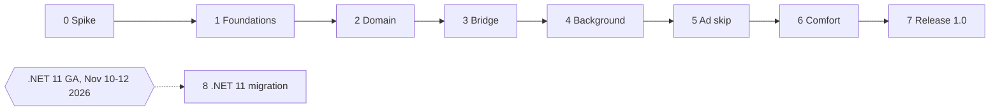

# Roadmap

The phases are ordered to remove the risks that could stop the project first, then to build from the inside out: domain rules before adapters, adapters before polish.

## How work flows through a phase

- Every step below is one branch (`feature/*`, `fix/*`, `refactor/*`, `test/*`, `docs/*`, `chore/*` or `ci/*`) and one pull request into `dev`, squash-merged. Phase 0 is the exception, described in its section. See [GIT_WORKFLOW.md](GIT_WORKFLOW.md).
- A step is done when its pull request is merged with all checks green.
- A phase is done when its definition of done is met on a real phone, not only in tests.
- When a phase is done, `dev` is merged into `master` and a release is published.

## Overview

| Phase | Name | Outcome | Release |
| --- | --- | --- | --- |
| 0 | Feasibility spike | The riskiest assumptions are confirmed or have a fallback | None (throwaway code) |
| 1 | Foundations | Repository, solution, quality gates and the full CI/CD pipeline work end to end | v0.1.0 |
| 2 | Domain and use cases | Playback rules and decisions exist and are fully tested in plain C# | v0.2.0 |
| 3 | Player and bridge | The app plays YouTube and C# controls the player through typed messages | v0.3.0 |
| 4 | Background playback | A playlist keeps playing with the screen off and the navigator open; system media controls work | v0.4.0 |
| 5 | Automatic ad skip | Skippable ads skip themselves; statistics and diagnostics exist | v0.5.0 |
| 6 | Hands-free comfort | Selected features from [FEATURES.md](FEATURES.md) | v0.6.0 |
| 7 | Release 1.0 | Polished, documented, installable by friends | v1.0.0 |
| 8 | .NET 11 migration | The app runs on .NET 11; can start as soon as .NET 11 is released | Next minor |

---

## Phase 0: Feasibility spike

**Goal:** prove or disprove the assumptions listed in [ARCHITECTURE.md, section 13](architecture/ARCHITECTURE.md#13-validated-by-the-feasibility-spike) before investing in structure.

**Branch:** `spike/feasibility`. Spike code is never merged into `dev`. Only the written report is.

**How the phase flows:** step 0.0 is the only direct push to `master` and `dev`, made before the rulesets exist. Steps 0.1 to 0.7 are commits on the spike branch, each reviewed before the next one starts. Step 0.8 is the only pull request of the phase.

### Steps

- [x] 0.0 Publish the documentation: create the public GitHub repository with `master` and `dev`, and apply the settings and rulesets from the one-time setup in [GIT_WORKFLOW.md](GIT_WORKFLOW.md). Status checks are added to the rulesets in step 1.1.
- [x] 0.1 Create a throwaway MAUI app targeting `net10.0-android` only.
- [x] 0.2 Load `https://m.youtube.com` in a WebView. Try Google sign-in with the default user agent, then with the `; wv` marker removed from the user agent. Record the result.
- [x] 0.3 Inject a visibility shield at document start with AndroidX WebKit `addDocumentStartJavaScript`. Switch to another app and confirm audio continues.
- [x] 0.4 Prototype Media3 `MediaSessionService` with a minimal `SimpleBasePlayer` subclass. Turn the screen off and run Google Maps navigation for 30 minutes. Confirm audio continues and navigation prompts duck the audio.
- [x] 0.5 Round-trip a message with `addWebMessageListener` restricted to the YouTube origin.
- [x] 0.6 Detect an ad and press Skip with a script click over at least 20 ads. If clicks are ignored, try a native tap with a `MotionEvent` at the button position.
- [x] 0.7 Leave the app in the background for one hour with "Don't keep activities" off and check whether the Activity and WebView survive.
- [x] 0.8 Write `docs/spikes/0001-feasibility.md` with results and decisions. Update the status of ADR 0002 and ADR 0006. Screenshots were left out, because a signed-in YouTube page shows the account and its history.

### Definition of done

- Every assumption has a recorded result: confirmed, or rejected with a chosen fallback.
- The report is merged into `dev` through a `docs/` pull request.

---

## Phase 1: Foundations

**Goal:** a repository where every quality gate already works, so later phases only add code.

### Steps

- [x] 1.1 Add the required status checks to both rulesets, now that every workflow has run at least once. Confirm that a pull request from a `feature/*` branch into `master` is blocked.
- [x] 1.2 Create `JHandsFree.slnx` and the five source projects with the references allowed by the dependency rule.
- [x] 1.3 Create the three test projects with xUnit v3, Shouldly and NSubstitute, each with one passing smoke test.
- [x] 1.4 Create `src/player-scripts` with TypeScript, esbuild, Vitest, ESLint and Prettier, with one passing test.
- [x] 1.5 Embed the script bundle in Infrastructure.Android through an MSBuild target that builds the scripts before the C# build.
- [x] 1.6 Add the DI extension methods `AddUseCases()`, `AddPlayerProtocol()`, `AddAndroidInfrastructure()`, `AddMessaging()`, `AddPresentation()` and wire them in `MauiProgram`. `AddMessaging()` calls `AddMediator` from Mediator 3.0.2 with the singleton lifetime. The app starts and shows an empty shell, and a Release build with trimming confirms the generated mediator works: the container validates every registration at startup.
- [x] 1.7 Confirm that CI now formats, builds and tests the solution and the player scripts instead of skipping with a notice, and that a failing test blocks the pull request. The CI and release workflows no longer detect whether the projects exist, so a missing project fails the checks instead of passing them.
- [x] 1.8 Create the signing keystore, store it as repository secrets and back it up offline. See [CI_CD.md](CI_CD.md).
- [x] 1.9 Merge `dev` into `master` and confirm the release workflow publishes `v0.1.0` with a signed APK. Install it on the phone through Obtainium.

### Definition of done

- A pull request into `dev` runs build, tests, script tests and formatting checks.
- A merge into `master` produces a signed APK on GitHub Releases that installs and updates through Obtainium.

Met on 19 October 2026 with v0.1.0: Obtainium installed the release on the phone, and the installed APK is identical to the release asset. The update through Obtainium can only be checked with the next release, so it is part of the phase 2 definition of done.

---

## Phase 2: Domain and use cases

**Goal:** all rules and decisions exist in plain C#, written test first.

### Steps

- [x] 2.1 Value objects `VideoId`, `VideoMetadata`, `AdBreak` with validation.
- [x] 2.2 `PlaybackSession` with the state machine from the architecture. One test per valid transition and tests for rejected transitions.
- [ ] 2.3 `SkipPolicy` and `PauseTimeoutPolicy`.
- [ ] 2.4 Messages as Mediator records: notifications for player events, commands for actions, queries for reads (see the architecture, section 7). `PlayerCommand` records for the page and the ports. `AddMessaging()` limits scanning to UseCases from this step: Mediator 3.0.2 refuses to scan an assembly whose compiled code does not use `Mediator.Abstractions` yet.
- [ ] 2.5 `PlaybackCoordinator` as a notification and command handler, tested by calling `Handle` directly with substitutes for the ports.
- [ ] 2.6 `AdSkipCoordinator`, tested the same way, including disabled policy, non-skippable ads, the skip delay, the locate-then-tap sequence, and a skip that counts only when the break ends within one second of the tap.
- [ ] 2.7 `IdlePromptCoordinator`, `SkipPolicyHandlers` and `SkipTotalsHandler`.
- [ ] 2.8 `IsolatingNotificationPublisher` and `LoggingBehavior`, each with unit tests.
- [ ] 2.9 Composition test in `JHandsFree.UseCases.Tests`: reference `Mediator.SourceGenerator`, build a real service provider, publish `AdBecameSkippable` and assert that `IPlayerCommands` received `LocateSkipButton`; publish to a failing handler and assert the other handlers still ran.

### Definition of done

- Line coverage of at least 90 percent on Domain and UseCases, enforced in CI.
- No reference to Android, MAUI or JSON in either project.
- Obtainium updates the installed v0.1.0 to v0.2.0 without uninstalling it.

---

## Phase 3: Player and bridge

**Goal:** the app plays YouTube, and C# controls the player through typed messages.

### Steps

- [ ] 3.1 `PlayerPage` with a WebView and a handler hook that exposes the native `Android.Webkit.WebView`. WebView remote debugging is enabled in Debug builds only.
- [ ] 3.2 `PlayerScriptInjector` with feature detection and a clear message when Android System WebView is too old. `Xamarin.AndroidX.WebKit` pinned as in ADR 0014.
- [ ] 3.3 `bridge-client` and `selectors` scripts with the message envelope.
- [ ] 3.4 `player-controller` script: state, metadata and commands.
- [ ] 3.5 PlayerProtocol translator with a `System.Text.Json` source-generated context, and contract fixtures in `tests/contract-fixtures/` tested from C# and TypeScript.
- [ ] 3.6 `WebViewPlayerBridge` implementing `IPlayerCommands` and publishing translated notifications through `IPublisher`.
- [ ] 3.7 Snapshot tests for the selectors against saved player markup.
- [ ] 3.8 Sign-in flow with the default WebView user agent, validated in phase 0. Confirm that the session survives an app restart, and record whether sign-in needs third-party cookies.

### Definition of done

- Play, pause and next work from C# commands on the phone.
- Player events arrive in C# as typed objects and are logged.

---

## Phase 4: Background playback and media controls

**Goal:** the core promise. A playlist plays with the screen off and the navigator in front, controlled from the steering wheel.

### Steps

- [ ] 4.1 `KeepVisibleWebView`, a `MauiWebView` subclass created by a custom WebView handler that reports its window as visible during background playback, and the `IPlayerVisibility` adapter. See ADR 0012.
- [ ] 4.2 `PlaybackService` as a Media3 `MediaSessionService` and `WebViewSessionPlayer` as a `SimpleBasePlayer`, with the AndroidX pins from ADR 0014. The session starts by itself when the page reports `playing`.
- [ ] 4.3 Manifest permissions `FOREGROUND_SERVICE` and `FOREGROUND_SERVICE_MEDIA_PLAYBACK`, notification permission request, and a one-time prompt to exclude the app from battery optimization.
- [ ] 4.4 Lock screen, notification, headphone and Bluetooth controls routed to `PlaybackCoordinator`. Decide what the session service does when a controller connects while no page exists.
- [ ] 4.5 `idle-prompt-watcher` script and `IdlePromptCoordinator` wired.
- [ ] 4.6 Release background playback after the pause timeout: stop the foreground service and allow the page to be hidden, so Chromium throttles it.
- [ ] 4.7 Field test in the car: one hour, screen off, navigator active, controls from the steering wheel. It also covers what the spike could not: the screen off for more than 10 minutes with the foreground service running, a Skip tap with the screen off, and the battery use of the always-visible WebView. Before it, check on an Android 17 emulator that audio started from the UI keeps playing in the background. Record the result in `docs/field-tests/`.

### Definition of done

- The field test passes without touching the phone after pressing play.

---

## Phase 5: Automatic ad skip

**Goal:** skippable ads skip themselves.

### Steps

- [ ] 5.1 `ad-watcher` script with a `MutationObserver` scoped to the player.
- [ ] 5.2 `AdSkipCoordinator` wired, with the native tap chosen in phase 0 (ADR 0013).
- [ ] 5.3 Settings screen for `SkipPolicy`.
- [ ] 5.4 SQLite repository for skip records and a statistics screen with total time saved.
- [ ] 5.5 Snapshot tests for ad markup variants, including breaks of two ads with the Skip button on either ad.
- [ ] 5.6 Diagnostics: a health warning when an ad looks skippable but no Skip button is found, and a log file the user can share.

### Definition of done

- Over 20 consecutive skippable ads in a field test, every one is skipped within one second of the Skip button appearing.

---

## Phase 6: Hands-free comfort

**Goal:** the most valuable candidate features from [FEATURES.md](FEATURES.md). The exact list is confirmed at the start of the phase.

### Steps

- [ ] 6.1 Drive mode screen with large controls.
- [ ] 6.2 Sleep timer.
- [ ] 6.3 Home screen shortcuts to favourite playlists.
- [ ] 6.4 Seek back and forward buttons in the notification, and configurable headphone double and triple press.
- [ ] 6.5 Resume the last session on launch.
- [ ] 6.6 Remote selector updates from a versioned JSON file in this repository.
- [ ] 6.7 Optional: sponsor segment skipping with SponsorBlock, after the license review.

### Definition of done

- Each selected feature passes its own acceptance criteria in [FEATURES.md](FEATURES.md).

---

## Phase 7: Release 1.0

### Steps

- [ ] 7.1 App icon, splash screen and display name.
- [ ] 7.2 About screen with version, license, disclaimer and third-party attributions.
- [ ] 7.3 README screenshots and a short demo GIF.
- [ ] 7.4 Release `v1.0.0`.
- [ ] 7.5 Obtainium setup guide for friends.

### Definition of done

- A friend installs the app from the README instructions without help.

---

## Phase 8: .NET 11 migration

**Goal:** move to .NET 11 after its release at .NET Conf 2026 (November 10 to 12). This phase can start at any point after the release, on its own branch `chore/dotnet-11-migration`.

### Steps

- [ ] 8.1 Update `global.json`, target frameworks (`net11.0`, `net11.0-android`) and all packages.
- [ ] 8.2 Confirm CommunityToolkit.Maui, Mediator, Media3 and WebKit bindings support .NET 11. Move Mediator to the latest stable 3.x if 3.0.2 has issues.
- [ ] 8.3 Verify the CoreCLR runtime on the phone: start time, APK size, background playback.
- [ ] 8.4 Update the JDK and Android SDK level in CI if required.
- [ ] 8.5 Repeat the phase 4 field test.
- [ ] 8.6 Write an ADR that records the migration result.

### Definition of done

- All checks green on .NET 11 and the field test passes.
