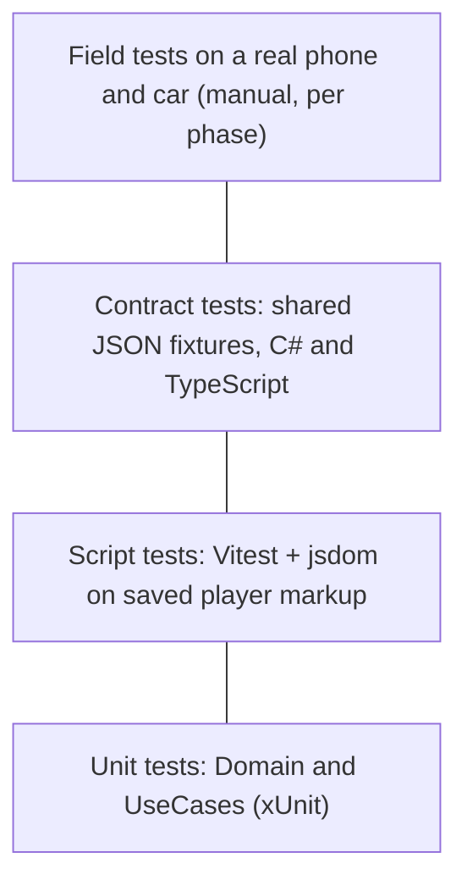

# Testing strategy

## Test pyramid



| Level | Project | Runs in CI | What it proves |
| --- | --- | --- | --- |
| Unit | `JHandsFree.Domain.Tests`, `JHandsFree.UseCases.Tests` | Yes | State machine transitions, policies, coordinator decisions |
| Architecture | One test in each test project | Yes | The assembly under test references only what the dependency rule allows |
| Composition | `JHandsFree.UseCases.Tests` with `Mediator.SourceGenerator` | Yes | The generated mediator routes each message to the right handler, and a failing notification handler does not stop the others |
| Protocol | `JHandsFree.Infrastructure.PlayerProtocol.Tests` | Yes | Every message in the contract parses and serializes correctly |
| Scripts | `src/player-scripts` with Vitest | Yes | Scripts detect ads, Skip buttons and prompts in real markup snapshots |
| Contract | Shared fixtures in `tests/contract-fixtures/` | Yes | C# and TypeScript agree on every message shape |
| Field | Manual, recorded in `docs/field-tests/` | No | The promise holds on a real phone with the screen off |

Android adapters are not unit tested on CI runners. Their logic is kept trivial and they are covered by the field tests.

## Tools

| Need | Tool |
| --- | --- |
| Test framework | xUnit v3, as `xunit.v3.mtp-off` so that `dotnet test` runs it through VSTest with the coverlet collector |
| Assertions | Shouldly |
| Test doubles | NSubstitute |
| Time | `FakeTimeProvider` from `Microsoft.Extensions.TimeProvider.Testing` |
| Coverage | coverlet, report in CI |
| Script tests | Vitest with jsdom |

See [ADR 0010](adr/0010-test-libraries.md) for why these libraries.

## Conventions

- **Name:** `Unit_Scenario_ExpectedOutcome`, for example `MarkAdSkippable_WhenNoAdIsPlaying_ReturnsInvalidTransition`.
- **Structure:** Arrange, Act, Assert, separated by a blank line. No comments needed.
- **One behaviour per test.** Several assertions are fine when they describe one outcome.
- **No logic in tests.** No loops or conditionals. Use `[Theory]` with data instead.
- **Deterministic.** No real time, no network, no randomness without a fixed seed.
- **Test data builders** for objects with many fields, for example `PlaybackSessionBuilder`.
- **Test the behaviour, not the implementation.** Assert on outcomes and commands sent through ports, not on private state.
- **Test first** for Domain and UseCases: write the failing test, make it pass, refactor.
- **Handlers are tested directly.** Call `Handle` on the coordinator with substitutes for its ports; do not go through the mediator in unit tests.

## Coverage

- Domain and UseCases: at least 90 percent line coverage, enforced in CI from phase 2.
- Coverage is a signal, not a goal. A missing test for a state transition is a defect even at 100 percent coverage.

## Contract fixtures

Each message type in the [contract](architecture/ARCHITECTURE.md#10-message-contract) has a JSON file in `tests/contract-fixtures/`. The C# protocol tests deserialize every fixture; the TypeScript tests type-check and produce the same JSON. A change to the contract changes a fixture and therefore fails both sides until both are updated.

## Markup snapshots

Saved HTML of the YouTube player in known states (content playing, ad with countdown, ad with Skip button, idle prompt) lives in `src/player-scripts/test/fixtures/`. When YouTube changes its markup, a new snapshot is added and the selector fix is tested against it.

## Field tests

Each field test uses the template below and is saved as `docs/field-tests/YYYY-MM-DD-short-title.md`.

```markdown
# Field test: <title>

- Date:
- App version:
- Phone and Android version:
- Android System WebView version:

## Scenario
## Steps
## Expected
## Result (pass or fail)
## Notes
```
