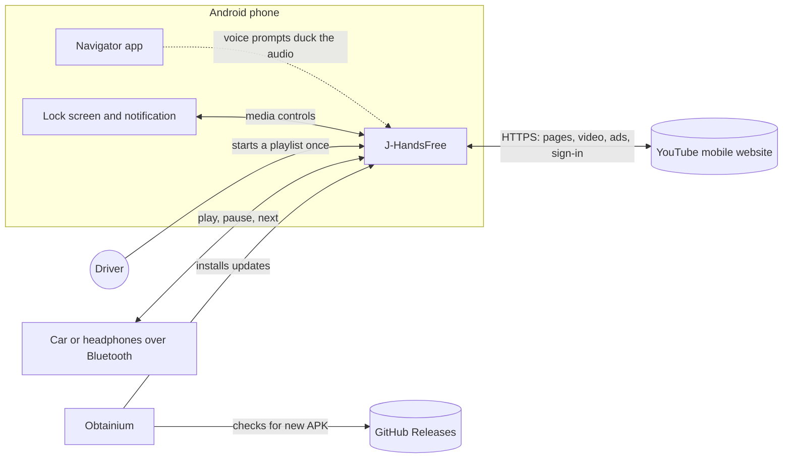
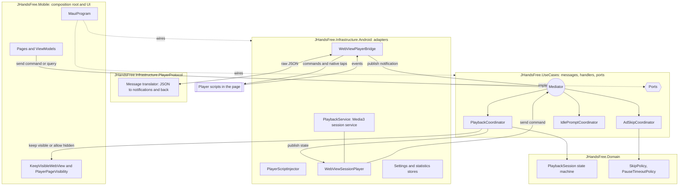
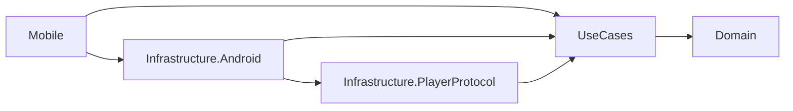
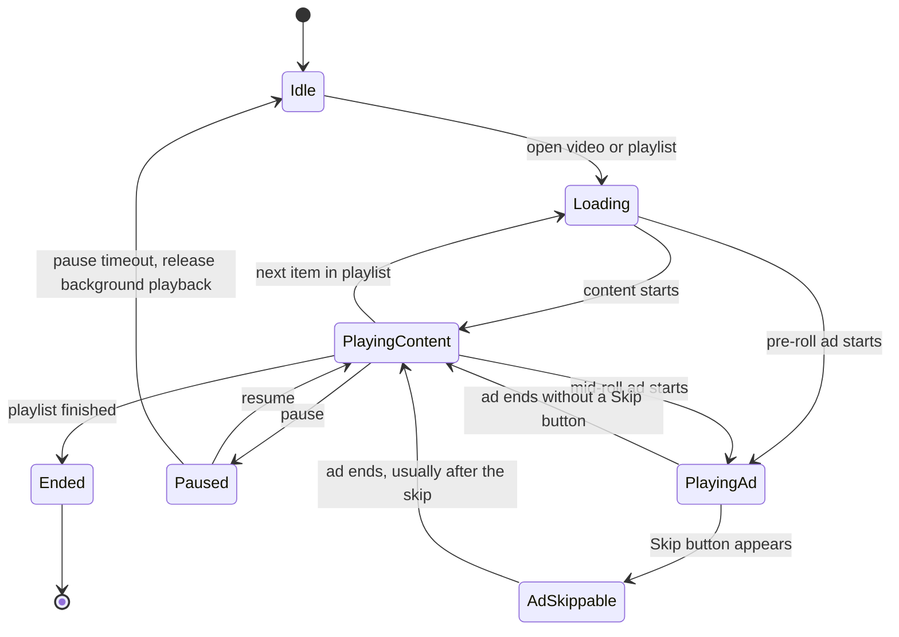
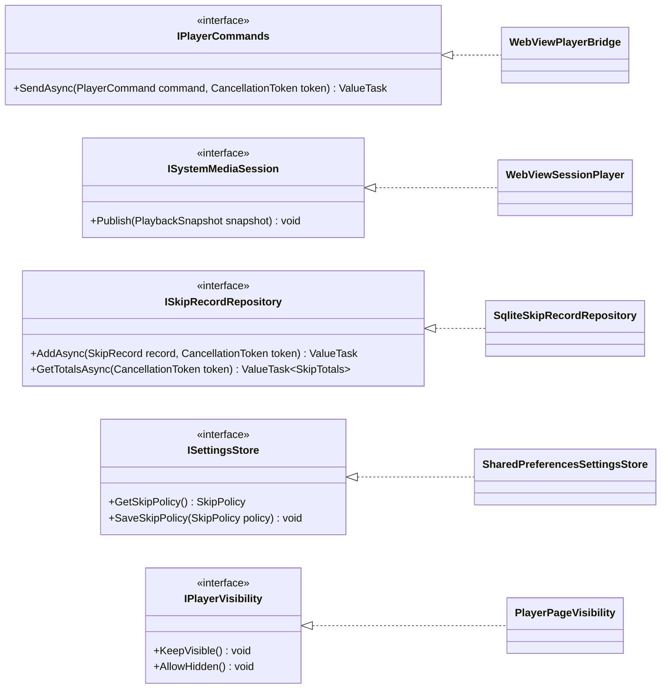
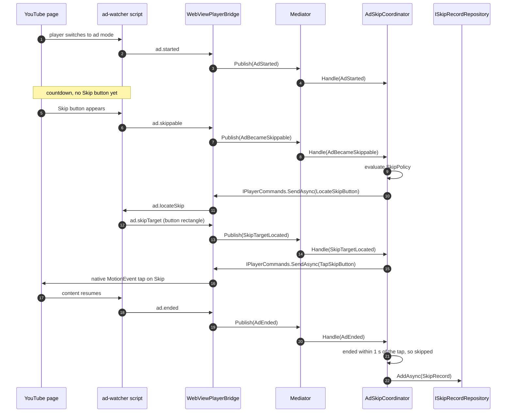
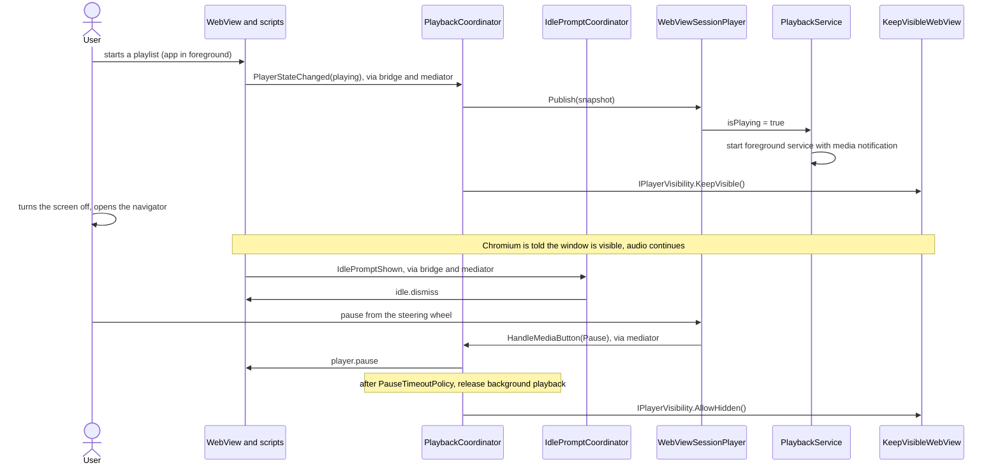
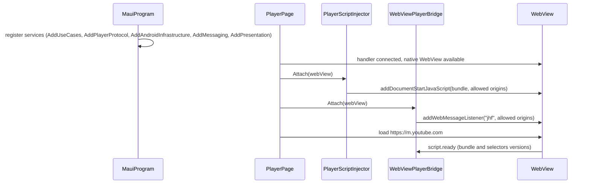

# Architecture

This document describes how J-HandsFree is built and why. Decisions are recorded in detail in the [ADRs](../adr/).

## 1. Goals and quality attributes

The product goal is simple: **once playback starts, the user never needs to touch the phone.** The architecture is shaped by these quality attributes, in priority order:

| Attribute | Scenario that must hold |
| --- | --- |
| Reliability in background | A one-hour playlist keeps playing with the screen off and a navigator in the foreground. |
| Resilience to YouTube changes | When YouTube changes its page markup, only player scripts or selector data change, never the core logic. |
| Testability | Playback rules and ad skip rules are tested without a phone, an emulator or a WebView. |
| Battery and data | No polling loops; observers are scoped to the player and react to changes only. |
| Privacy and security | Scripts talk to the app only from allowed YouTube origins. No remote code is ever executed. |

## 2. Architectural style

J-HandsFree follows **Clean Architecture** as described by Robert C. Martin, implemented with **ports and adapters** (hexagonal architecture), and uses **MVVM** in the presentation layer.

- The **Domain** holds the playback state machine and the rules (skip policy, pause timeout). It has no dependencies.
- The **Use cases** layer reacts to player events, applies domain rules and issues commands. It defines **ports** (interfaces) for everything outside the process boundary.
- **Adapters** implement the ports: the WebView bridge, the Media3 session, settings storage, statistics storage.
- The **Mobile** project is the composition root: it wires everything together and hosts the UI.
- Inside the process, messages are dispatched with the source-generated **Mediator** library: player events are notifications, user and system actions are commands, reads are queries. See section 7.

CQRS was considered and rejected for this scope ([ADR 0003](../adr/0003-clean-architecture-without-cqrs.md)). The mediator is used for in-process dispatch only ([ADR 0011](../adr/0011-source-generated-mediator.md)).

## 3. System context



## 4. Components inside the app



**Event flow (upwards):** the page changes, a script notices, the bridge receives the message, the protocol translator turns it into a notification, the mediator delivers it to every interested coordinator, and each coordinator updates the domain and decides.

**Command flow (downwards):** a coordinator issues a command through the `IPlayerCommands` port, the bridge serializes it, a script executes it in the page. Pressing Skip is the exception: the script only reports where the button is, and the bridge taps it natively ([ADR 0013](../adr/0013-native-tap-to-press-skip.md)).

Media buttons from the lock screen, the notification and Bluetooth reach `WebViewSessionPlayer`, which sends a command through the mediator to `PlaybackCoordinator`. There is one place that decides what the player does.

## 5. Solution structure

```text
J-HandsFree/
├─ JHandsFree.slnx
├─ Directory.Build.props
├─ Directory.Packages.props
├─ global.json
├─ src/
│  ├─ JHandsFree.Domain/                         net10.0
│  ├─ JHandsFree.UseCases/                       net10.0
│  ├─ JHandsFree.Infrastructure.PlayerProtocol/  net10.0
│  ├─ JHandsFree.Infrastructure.Android/         net10.0-android
│  ├─ JHandsFree.Mobile/                         net10.0-android (MAUI app)
│  └─ player-scripts/                            TypeScript, bundled to one file
├─ tests/
│  ├─ JHandsFree.Domain.Tests/                   xUnit
│  ├─ JHandsFree.UseCases.Tests/                 xUnit
│  ├─ JHandsFree.Infrastructure.PlayerProtocol.Tests/  xUnit
│  └─ contract-fixtures/                         JSON shared by C# and TypeScript tests
├─ docs/
└─ .github/
```

| Project | Target | Contains | References |
| --- | --- | --- | --- |
| `JHandsFree.Domain` | `net10.0` | Entities, value objects, state machine, policies | Nothing |
| `JHandsFree.UseCases` | `net10.0` | Notifications, commands and queries; coordinators and handlers; ports; `IsolatingNotificationPublisher` and `LoggingBehavior`; DI extension `AddUseCases()` | Domain, `Mediator.Abstractions` |
| `JHandsFree.Infrastructure.PlayerProtocol` | `net10.0` | Message envelope DTOs, `System.Text.Json` source-generated context, translation between JSON and use case events and commands; DI extension `AddPlayerProtocol()` | UseCases |
| `JHandsFree.Infrastructure.Android` | `net10.0-android` | Adapters for WebView, Media3, storage; embedded script bundle; DI extension `AddAndroidInfrastructure()` | UseCases, PlayerProtocol |
| `JHandsFree.Mobile` | `net10.0-android` | `MauiProgram`, pages, view models, Android manifest; `KeepVisibleWebView`, its WebView handler and the `PlayerPageVisibility` adapter; DI extensions `AddMessaging()` (the `AddMediator` call) and `AddPresentation()` | All of the above, `Mediator.SourceGenerator` |
| `player-scripts` | TypeScript | Ad watcher, idle prompt watcher, player controller | Nothing; its bundle is embedded in Infrastructure.Android |

The protocol translation is a separate plain `net10.0` project so it can be unit tested on any CI runner. Code that targets `net10.0-android` cannot run on a Linux test host.

### Naming notes

- The use case layer is called `UseCases`, the name Clean Architecture gives this circle. Calling it `Application` would collide with MAUI's `Application` base class: inside `namespace JHandsFree.Mobile`, the name `Application` would resolve to the `JHandsFree.Application` namespace and break `App : Application`.
- The MAUI project is `JHandsFree.Mobile`, not `JHandsFree.App`, so the `App` class does not share its name with its namespace.
- The repository and product are named `J-HandsFree`; C# identifiers cannot contain a hyphen, so the root namespace is `JHandsFree`.

### Dependency rule



Source code dependencies point inwards only. The Domain knows nothing about Android, MAUI, JSON or YouTube's markup. The rule is enforced by project references and checked by one test in each test project, which fails when the assembly under test references something the rule forbids.

## 6. Domain model

| Type | Kind | Responsibility |
| --- | --- | --- |
| `PlaybackSession` | Entity, aggregate root | Holds the current state, the current video and the current ad break. Accepts only valid transitions. |
| `PlaybackState` | Enum | `Idle`, `Loading`, `PlayingContent`, `PlayingAd`, `AdSkippable`, `Paused`, `Ended` |
| `VideoMetadata` | Value object | `VideoId`, title, channel, and the duration when it is known (not for a live stream) |
| `VideoId` | Value object | Validated YouTube video identifier: eleven characters from `A-Z`, `a-z`, `0-9`, `-` and `_` |
| `AdBreak` | Value object | One ad break, whatever the number of ads in it: kind, start time, whether it became skippable. The kind is `Unknown` until the Skip button appears or the break ends |
| `AdKind` | Enum | `Unknown` (the default), `Skippable`, `NonSkippable` |
| `SkipPolicy` | Policy | Whether auto skip is enabled and the delay before pressing Skip, from zero to ten seconds (default: enabled, no delay). `ShouldSkip` allows only a skippable break |
| `PauseTimeoutPolicy` | Policy | How long a pause may last before background playback is released (default 10 minutes, as long as Media3 keeps the foreground service after a pause). `HasExpired` receives both instants, so the domain never reads a clock |
| `SkipRecord` | Value object | What was skipped, when, and how many seconds it saved |

### Playback state machine



Every transition not drawn above is invalid and is rejected by `PlaybackSession`. Each edge has a unit test. A rejected request returns an invalid `TransitionResult` and changes nothing, because player events can arrive out of order or twice; the coordinator logs it and carries on.

The current video is not part of the state. `StartContent` sets it, and `UpdateVideo` replaces it while an item is active without changing the state, which covers the content that follows a pre-roll ad.

## 7. Use cases, messages and ports

### Messages

Messages are immutable records in UseCases. They are dispatched in process by Mediator 3.0.2 ([ADR 0011](../adr/0011-source-generated-mediator.md)).

| Kind | Mediator type | Naming | Examples | Sent by |
| --- | --- | --- | --- | --- |
| Notification | `INotification` | Past tense | `PlayerStateChanged`, `AdStarted`, `AdBecameSkippable`, `AdEnded`, `SkipTargetLocated`, `IdlePromptShown`, `ScriptReady`, `ScriptFailed` | `WebViewPlayerBridge` through `IPublisher` |
| Command | `ICommand` | Imperative | `HandleMediaButton`, `OpenPlaylist`, `UpdateSkipPolicy` | `WebViewSessionPlayer`, view models, through `ISender` |
| Query | `IQuery<T>` | `Get...` | `GetSkipPolicy`, `GetSkipTotals` | View models, through `ISender` |

### Coordinators and handlers

| Handler | Handles | Decides | Uses ports |
| --- | --- | --- | --- |
| `PlaybackCoordinator` | `PlayerStateChanged`, `HandleMediaButton`, `OpenPlaylist` | Updates the session; keeps the system media session in sync; forwards play, pause, next; keeps the page visible during background playback and allows it to be hidden after the pause timeout | `IPlayerCommands`, `ISystemMediaSession`, `IPlayerVisibility`, `TimeProvider` |
| `AdSkipCoordinator` | `AdStarted`, `AdBecameSkippable`, `SkipTargetLocated`, `AdEnded` | Applies `SkipPolicy`; sends `LocateSkipButton`, then `TapSkipButton` with the reported rectangle; records a `SkipRecord` when the break ends within one second of the tap | `IPlayerCommands`, `ISkipRecordRepository`, `ISettingsStore`, `TimeProvider` |
| `IdlePromptCoordinator` | `IdlePromptShown` | Dismisses the "Continue watching?" prompt | `IPlayerCommands` |
| `SkipPolicyHandlers` | `GetSkipPolicy`, `UpdateSkipPolicy` | Reads and saves the user's skip settings | `ISettingsStore` |
| `SkipTotalsHandler` | `GetSkipTotals` | Returns the statistics for the stats screen | `ISkipRecordRepository` |

Coordinators are singletons, the Mediator default, so playback state lives in one place for the whole process.

### Cross-cutting behaviour

| Component | Mediator extension point | Job |
| --- | --- | --- |
| `IsolatingNotificationPublisher` | `INotificationPublisher`, set with `NotificationPublisherType` | Runs notification handlers one by one, logs a failing handler with context and continues with the next. No exception reaches the bridge or the WebView. |
| `LoggingBehavior<TMessage, TResponse>` | `IPipelineBehavior`, set with `PipelineBehaviors` | Logs every command and query with its duration and outcome. |

### Ports

Ports remain for everything that crosses the process boundary. The mediator never replaces them.



Inbound traffic uses the mediator instead of ports: the bridge publishes notifications through `IPublisher`, and `WebViewSessionPlayer` sends `HandleMediaButton` through `ISender`.

Time is read through the built-in `TimeProvider` abstraction instead of a custom clock interface. Production code receives `TimeProvider.System`; tests receive `FakeTimeProvider`, so timeouts and statistics are tested without waiting for real time.

## 8. Adapters (Infrastructure.Android)

| Adapter | Built on | Notes |
| --- | --- | --- |
| `WebViewPlayerBridge` | AndroidX WebKit `addWebMessageListener` | Receives messages only from allowed origins; replies through the reply proxy. Delegates parsing and serialization to the PlayerProtocol translator, then publishes the resulting notification through Mediator's `IPublisher`. Implements `IPlayerCommands`. Executes `TapSkipButton` natively: converts the rectangle to physical pixels and dispatches a `MotionEvent` pair to the WebView on the UI thread. |
| `PlayerScriptInjector` | AndroidX WebKit `addDocumentStartJavaScript` | Injects the bundle before any page script runs, so the observers are in place before the player starts. Feature support is checked at runtime. |
| `PlaybackService` | Media3 `MediaSessionService` | Owns the media session, the notification and the foreground service of type `mediaPlayback`. |
| `WebViewSessionPlayer` | Media3 `SimpleBasePlayer` | A player facade whose state comes from `PlaybackSession`. It does not decode media; it mirrors the WebView and sends `HandleMediaButton` commands through Mediator's `ISender`. Implements `ISystemMediaSession`. |
| `SharedPreferencesSettingsStore` | Android `SharedPreferences` | Small key-value settings, without a MAUI dependency in Infrastructure. |
| `SqliteSkipRecordRepository` | SQLite | Skip statistics. The library is chosen in phase 5. |

The WebView itself is created by the Mobile project (it is a UI element): a custom WebView handler creates `KeepVisibleWebView`, a subclass of MAUI's `MauiWebView` that reports its window as visible to Chromium while background playback is active ([ADR 0012](../adr/0012-native-window-visibility-for-background-playback.md)). `PlayerPageVisibility`, also in Mobile, implements `IPlayerVisibility` by switching that override; it is the one adapter outside Infrastructure.Android, because the view it controls is a MAUI type. When the MAUI handler connects, the native `Android.Webkit.WebView` is handed to the bridge and the injector. Infrastructure never references MAUI.

## 9. Player scripts

The scripts run inside the YouTube page. They are deliberately thin: they observe and act, they never decide.

| Module | Job |
| --- | --- |
| `ad-watcher` | Observes the player container with a `MutationObserver`; reports `ad.started`, `ad.skippable`, `ad.ended`; when asked, reports the Skip button's rectangle. It never clicks: YouTube ignores script clicks, so the bridge taps natively ([ADR 0013](../adr/0013-native-tap-to-press-skip.md)). |
| `idle-prompt-watcher` | Reports the "Continue watching?" dialog; confirms it when commanded. |
| `player-controller` | Reports player state and metadata; executes play, pause, next, previous, seek and rate commands. |
| `bridge-client` | Wraps `postMessage`, adds the envelope and protocol version, handles replies. |
| `selectors` | All CSS selectors in one module, so a YouTube markup change is a one-file fix. |

Background playback does not depend on a script. Chromium suspends the page's media when the WebView's window is not visible, whatever the page is told, so `KeepVisibleWebView` keeps reporting the window as visible ([ADR 0012](../adr/0012-native-window-visibility-for-background-playback.md)).

## 10. Message contract

Every message in both directions uses one envelope. The protocol version lets the app reject a stale script bundle.

```json
{
  "protocol": 1,
  "type": "ad.skippable",
  "sentAtMs": 1792168839000,
  "payload": {}
}
```

### Events (page to app)

| Type | Payload |
| --- | --- |
| `script.ready` | `bundleVersion`, `selectorsVersion` |
| `player.state` | `state` (`playing`, `paused`, `buffering`, `ended`), `videoId`, `title`, `channel`, `positionSeconds`, `durationSeconds` |
| `ad.started` | none |
| `ad.skippable` | none |
| `ad.ended` | none |
| `ad.skipTarget` | `x`, `y`, `width`, `height` of the Skip button in CSS pixels and the page's `devicePixelRatio`, sent after `ad.locateSkip` |
| `idle.prompt.shown` | none |
| `script.error` | `code`, `message` |

### Commands (app to page)

| Type | Payload |
| --- | --- |
| `player.play` / `player.pause` | none |
| `player.next` / `player.previous` | none |
| `player.seekBy` | `seconds` (negative to go back) |
| `player.setRate` | `rate` |
| `ad.locateSkip` | none; the page answers with `ad.skipTarget` |
| `idle.dismiss` | none |

Unknown types are logged and ignored. A malformed message never crashes the app.

## 11. Key flows

### Automatic ad skip



Non-skippable ads are never skipped; the coordinator only records them. A break of two ads is one `AdBreak`, and the Skip button can appear on either ad. If a handler throws, `IsolatingNotificationPublisher` logs it and the bridge carries on.

### Background playback



The foreground service must be started while the app is still visible. Android 17 restricts audio from apps without a foreground service started with while-in-use capability, so playback always starts from the UI.

The foreground service is also what keeps the process alive. Without it the process is cached, and the phone kills it within minutes: the spike saw HyperOS kill cached apps 10 minutes after the screen locks, and Android kill a cached process that used more than 5 % of a core ([spike report](../spikes/0001-feasibility.md#survival-in-the-background-step-07)). Allowing the page to be hidden after the pause timeout lets Chromium throttle it once background playback is released.

### Startup and script injection



## 12. Cross-cutting concerns

| Concern | Approach |
| --- | --- |
| Dependency injection | `Microsoft.Extensions.DependencyInjection` in `MauiProgram`, one extension method per layer: `AddUseCases()`, `AddPlayerProtocol()`, `AddAndroidInfrastructure()`, `AddMessaging()`, `AddPresentation()`. |
| Messaging | Mediator 3.0.2, source-generated, singleton lifetime, scanning limited to the UseCases assembly. Configured once in `AddMessaging()`. |
| Logging | `Microsoft.Extensions.Logging` abstractions everywhere. `LoggingBehavior` logs commands and queries; `IsolatingNotificationPublisher` logs failing notification handlers. A file sink on the device supports diagnostics export (phase 5). |
| Threading | Bridge callbacks arrive on the UI thread. Coordinators are thread-agnostic and never block. Adapters marshal to the main thread when touching Android views. |
| Errors | Scripts report failures as `script.error`; the bridge never throws into the WebView; `IsolatingNotificationPublisher` isolates each notification handler, so one failure does not stop the others. |
| Configuration | User settings in `ISettingsStore`. Selector data can be refreshed from a versioned JSON file in this repository (data only, never code). |
| Serialization | `System.Text.Json` with source generation in the PlayerProtocol project, so trimming in Release builds is safe. |
| Time | `TimeProvider` everywhere; never `DateTime.Now`. |
| Security | Script injection and messaging are restricted to allowed YouTube origins. No `eval`, no remote scripts. |
| Performance | Observers watch the player container only. No timers that poll the page. After the pause timeout the page may be hidden again, so Chromium throttles it. |

## 13. Validated by the feasibility spike

These points were assumptions until phase 0 tested them on a real phone. The [spike report](../spikes/0001-feasibility.md) has the measurements.

1. Google sign-in works inside the WebView. **Confirmed** with the default WebView user agent.
2. The WebView keeps playing audio in the background while the foreground service runs. **Confirmed, with a native window visibility override** ([ADR 0012](../adr/0012-native-window-visibility-for-background-playback.md)); a page script alone does not work. The long screen-off run is part of the field test in roadmap step 4.7.
3. `addDocumentStartJavaScript` and `addWebMessageListener` are available through the .NET AndroidX WebKit bindings. **Confirmed** with `Xamarin.AndroidX.WebKit` 1.14.0.1 ([ADR 0014](../adr/0014-androidx-alignment-and-android-6-minimum.md)).
4. Media3 `SimpleBasePlayer` can be subclassed from .NET and drive the media notification. **Confirmed** with Media3 1.11.1, which needs aligned AndroidX versions and Android 6.0 ([ADR 0014](../adr/0014-androidx-alignment-and-android-6-minimum.md)).
5. The Activity is not destroyed while backgrounded during a one-hour session. **Confirmed**: it was never destroyed on its own. Without the foreground service the whole process is killed instead, so the WebView stays in the Activity and the foreground service runs whenever audio plays.
6. The Skip button accepts a click dispatched by a script. **Rejected**: YouTube ignores script clicks. The planned fallback, a native tap at the rectangle the script reports, skipped 20 ads out of 20 ([ADR 0013](../adr/0013-native-tap-to-press-skip.md)).

One more assumption is checked in phase 1 rather than in the spike: Mediator 3.0.2 generates and runs correctly for `net10.0` libraries and for the `net10.0-android` app with trimming enabled.
